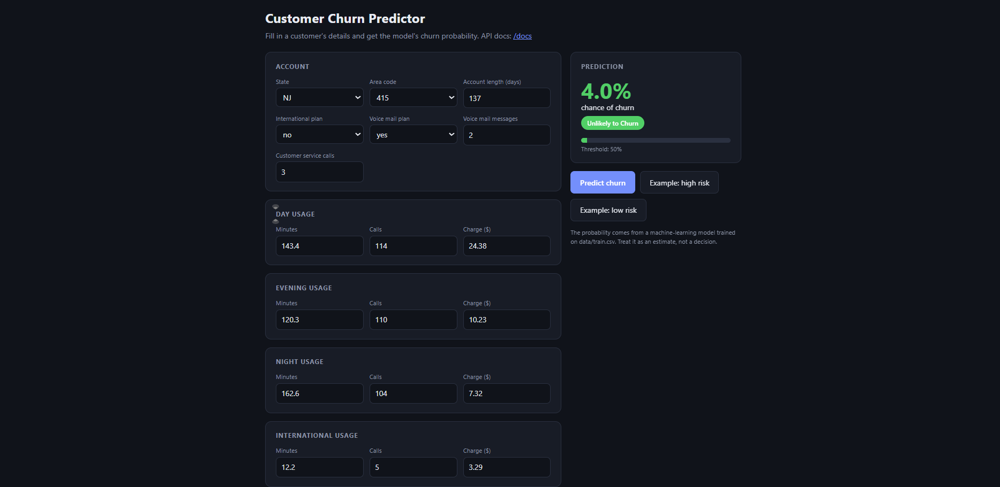

# Customer Churn Prediction

"Churn" means a customer stops using a service. This project predicts which **telecom customers are likely to leave**,
so a company can contact them before they go.

You enter a customer's details (plan, calls, minutes, charges, support calls) and the app shows the **chance that the
customer will leave**.



## What this project does
- Trains four machine-learning models and compares them: Logistic Regression, Decision Tree, Random Forest and XGBoost.
- Keeps the best model and uses it to make predictions.
- Provides two easy ways to try it: a web form and a Streamlit app.
- You can also upload a CSV file with many customers and get a prediction for each one.

## Technologies used
| Purpose | Tools |
|---|---|
| Language | Python |
| Data handling | pandas, NumPy |
| Machine learning | scikit-learn (Logistic Regression, Decision Tree, Random Forest), XGBoost |
| Saving the model | joblib |
| Web form and prediction service | FastAPI, Uvicorn, Pydantic |
| Interactive app | Streamlit |
| Testing | pytest |
| Tools | Git and GitHub, VS Code |

## Dataset
Telecom customer churn data from Kaggle: [Telecom Churn Datasets](https://www.kaggle.com/datasets/mnassrib/telecom-churn-datasets)
- 2,666 customers for training and 667 for testing.
- 19 details per customer, such as account length, international plan, voice mail plan, day / evening / night / international
  usage, and number of customer service calls.
- About 15 out of every 100 customers leave.
- The data is clean: no missing values and no duplicate rows.

## Results
Tested on 667 customers that the model had never seen:

| Model | Accuracy | Precision | Recall |
|---|---|---|---|
| Logistic Regression | 77.7% | 36.5% | 76.8% |
| Decision Tree | 92.2% | 70.1% | 78.9% |
| Random Forest | 95.4% | 89.0% | 76.8% |
| **XGBoost (chosen)** | 95.2% | 82.5% | **84.2%** |

- **Recall** = of the customers who really left, how many the model caught.
- **Precision** = when the model says "will leave", how often it is right.
- XGBoost was chosen because it catches the most customers who leave (84%) while staying accurate.

## How to run
You need **Python 3.10 or newer**. Run these commands in the project folder.

1. Install the requirements:
   ```
   python -m venv .venv
   .venv\Scripts\activate
   python -m pip install -r requirements.txt
   ```
   (On Mac/Linux, use `source .venv/bin/activate` instead of the second line.)

2. Train the model (this also compares the four models):
   ```
   python -m app.services.train_model --data-path data/train.csv --output app/models/churn_pipeline.pkl
   ```

3. Start the app. Choose one:

   **Option A: web form**
   ```
   python -m uvicorn app.main:app --reload
   ```
   Open http://127.0.0.1:8000 in your browser.

   **Option B: Streamlit**
   ```
   python -m streamlit run streamlit_app.py
   ```
   Open http://localhost:8501 in your browser.

To predict for many customers at once, use the **Batch CSV** tab in Streamlit and upload `data/sample_upload.csv`.

To stop the app, press `Ctrl + C` in the terminal.

## Project structure
```
app/               the prediction code and the web form
streamlit_app.py   the Streamlit app
prepare_data.py    cleans the raw Kaggle files into data/train.csv and data/test.csv
data/              training data, test data and a sample file to upload
tests/             automatic tests
```

## Limitations
The model learns from one public dataset, so its predictions are estimates, not guarantees.

## Ideas for improvement
- Show which details push a customer's churn risk up or down.
- Try more models and tune their settings.
- Test the model on data from another telecom company.

## Author
**Kotha Harishankar**

- GitHub: [github.com/kothaharishankar](https://github.com/kothaharishankar)
- LinkedIn: [linkedin.com/in/harishankar-kotha-0966b1291](https://www.linkedin.com/in/harishankar-kotha-0966b1291/)
